<div align="center">

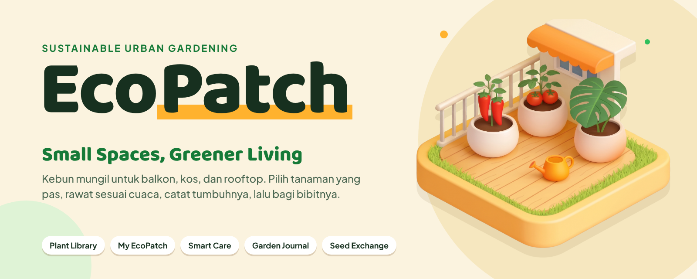

<br>


**[Coba langsung](https://salwa-alifia-eco-patch.pws.cs.ui.ac.id/)** &nbsp;·&nbsp; **[Video demo](https://www.youtube.com/watch?v=61f5_0513Ck)** &nbsp;·&nbsp; **[Desain di Figma](https://www.figma.com/design/oIDtpZy29QWfdudwhSFNb5/Untitled?node-id=0-1&t=LuUIQFP3lihxES26-1)** &nbsp;·&nbsp; **[Jalankan lokal](#-jalankan-di-lokal)** &nbsp;·&nbsp; **[Tim](#-tim)**

</div>

<br>

Balkon dua meter, kamar kos dengan satu jendela, atau rooftop yang kepanasan: semuanya bisa jadi kebun. **EcoPatch** membantu kamu tahu tanaman apa yang cocok, kapan harus menyiram, sudah sejauh apa tumbuhnya, dan ke mana bibit sisa bisa pergi. Semuanya ada di satu tempat.

Ini adalah website EcoPatch yang dibangun dengan **Django** untuk Proyek Tengah Semester mata kuliah Pemrograman Berbasis Platform (PBP) Gasal 2026/2027. Subtema kami adalah **Sustainable Living › Urban Farming**: ruang sempit tetap bisa dihijaukan, dan bibit tidak terbuang karena bisa dipakai orang lain lewat Seed Exchange.

---

## Demo

> **Lihat langsung.** Satu alur dari memilih tanaman sampai membagikan bibit, satu gambar per fitur (screenshot dari aplikasi yang berjalan dengan data contoh).

<!--
  Gambar di bawah masih screenshot statis (docs/readme/demo-*.jpg). Untuk menggantinya dengan GIF/MP4 dari aplikasi yang berjalan:
  1. Rekam klip pendek (5 sampai 15 detik), lalu seret filenya ke kotak komentar PR atau issue di GitHub.
     GitHub memberi alamat https://github.com/user-attachments/assets/... : salin alamat itu (jangan kirim komentarnya).
  2. Ganti nilai src pada gambar di sel yang sesuai dengan alamat itu.
  3. Video penuh: sudah ada di baris tautan paling atas README (Video demo).
  Pakai akun demo. Jangan sampai terlihat: file .env, token, password, atau nomor kontak asli.
-->

<table>
  <tr>
    <td width="50%" valign="top">
      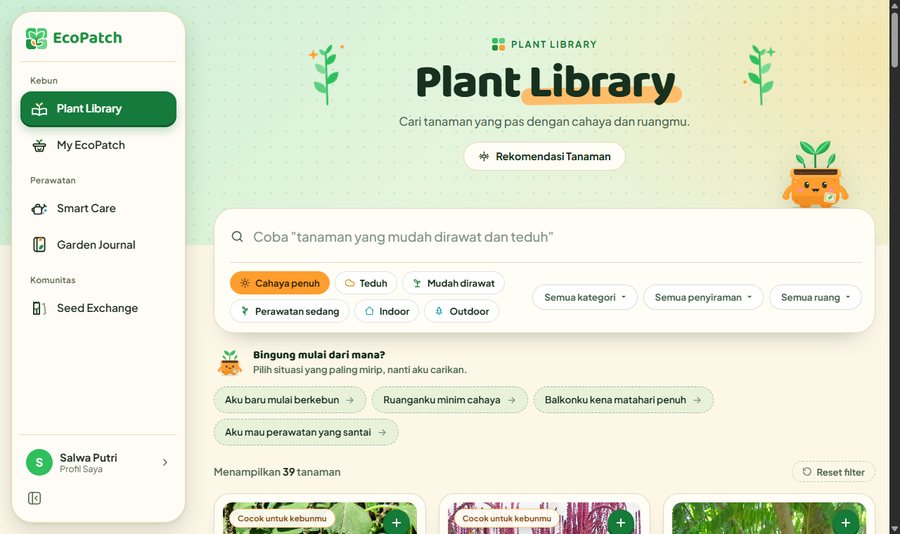
      <b>① Cari tanaman</b><br/>
      <sub>Cari berdasarkan nama, saring dengan cahaya, ruang, dan tingkat kesulitan. Klik kartu untuk membuka detailnya dalam pop-up.</sub>
    </td>
    <td width="50%" valign="top">
      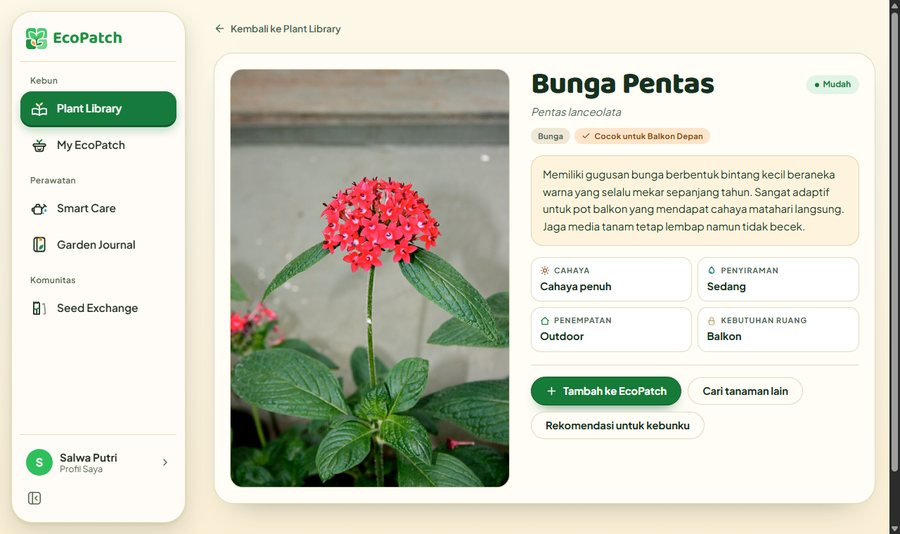
      <b>② Tambah ke EcoPatch</b><br/>
      <sub>Dari kartu atau pop-up tanaman, tekan tambah dan pilih kebunmu. Tiap kebun menunjukkan seberapa cocok tanamannya, tanpa pindah halaman.</sub>
    </td>
  </tr>
  <tr>
    <td width="50%" valign="top">
      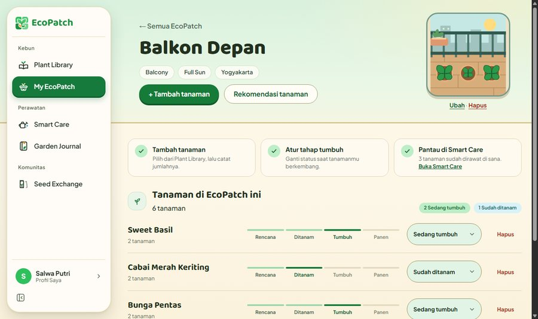
      <b>③ Kelola kebun</b><br/>
      <sub>Buat EcoPatch dengan jenis ruang, cahaya, dan kota. Atur tanamannya dari bibit sampai tumbuh.</sub>
    </td>
    <td width="50%" valign="top">
      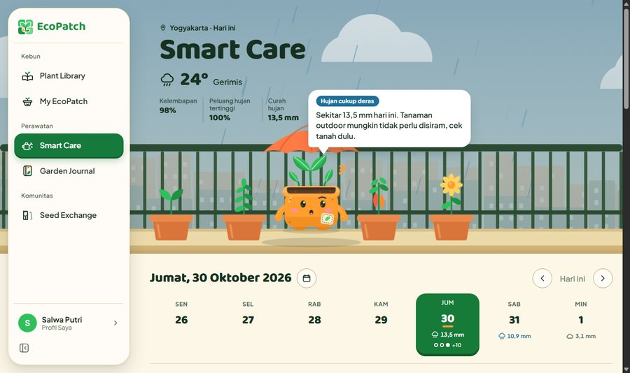
      <b>④ Rawat sesuai cuaca</b><br/>
      <sub>Smart Care membaca prakiraan Open-Meteo untuk kotamu dan memberi saran per tanaman. Centang tugas yang sudah selesai.</sub>
    </td>
  </tr>
  <tr>
    <td width="50%" valign="top">
      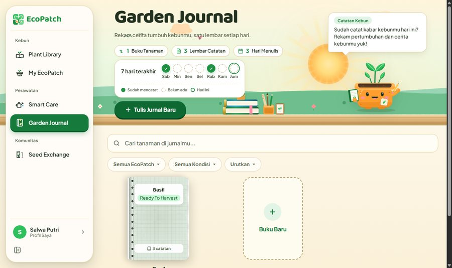
      <b>⑤ Catat perkembangan</b><br/>
      <sub>Garden Journal menyimpan catatan dan foto tiap tanaman dalam satu timeline.</sub>
    </td>
    <td width="50%" valign="top">
      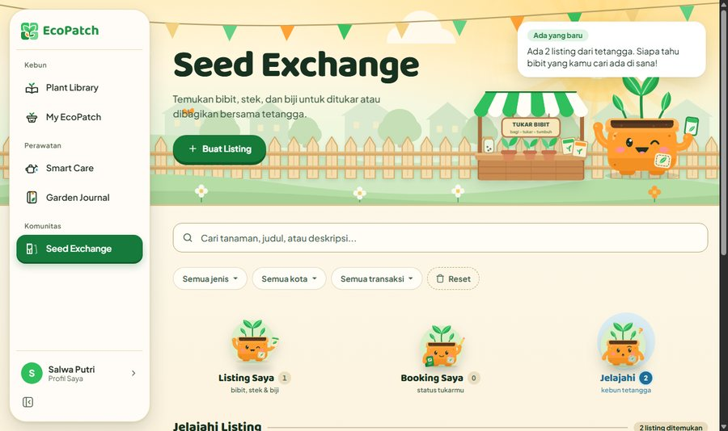
      <b>⑥ Bagikan bibit</b><br/>
      <sub>Pasang bibit atau stek berlebih di Seed Exchange, lalu orang lain memesannya. Statusnya tersedia, diminta, dipesan, sampai selesai.</sub>
    </td>
  </tr>
</table>

---

## Kenapa orang berhenti berkebun

Niat sudah ada, tapi lima hal ini sering menghentikan di tengah jalan. Tiap hal punya satu modul yang menjawabnya.

| Yang terpikir | Yang EcoPatch lakukan |
| --- | --- |
| "Tanaman apa yang cocok di balkonku?" | **Plant Library** menyaring tanaman berdasarkan cahaya, ruang, dan tingkat kesulitan, lalu merekomendasikan yang pas. |
| "Ruangku kecil dan teduh. Mulai dari mana?" | **My EcoPatch** menyimpan kebun virtualmu: jenis ruang, cahaya, kota, dan tanaman di dalamnya. |
| "Lupa menyiram. Atau menyiram padahal hujan." | **Smart Care** menjadwalkan perawatan dan memberi saran dari cuaca kotamu hari ini. |
| "Sudah sejauh mana tumbuhnya, ya?" | **Garden Journal** mencatat perkembangan tanaman dalam satu timeline. |
| "Bibit dan stekku berlebih." | **Seed Exchange** mempertemukanmu dengan orang yang mau menerima atau menukarnya. Tanpa pembayaran. |

**Untuk siapa:** mahasiswa kos, penghuni apartemen, warga kota dengan lahan terbatas, pemula yang baru mau mulai, dan siapa pun yang ingin hidup lebih berkelanjutan.

---

## Satu siklus, lima modul

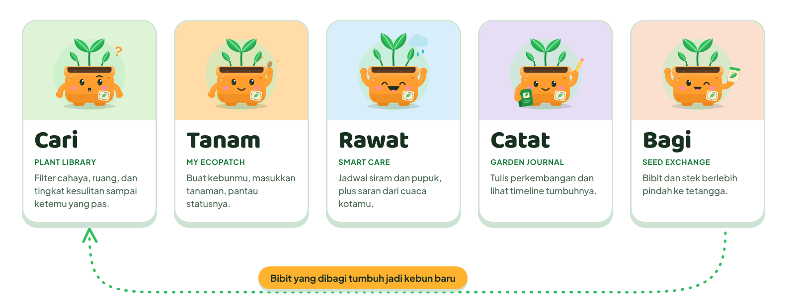

| Modul | Fungsinya | Model | PIC |
| --- | --- | --- | --- |
| **Plant Library & Recommendation** | Katalog 60 tanaman dengan pencarian, filter, dan rekomendasi sesuai kondisi EcoPatch | `Plant` | Nurul Fikryati Bena |
| **My EcoPatch** | Kebun virtual: tipe ruang, cahaya, kota, tujuan, dan status tiap tanaman | `EcoPatch`, `PatchPlant` | Haikal Rafka A Rahman |
| **Smart Care** | Jadwal perawatan dengan saran dari cuaca kota (Open-Meteo) | `CareTask` | Salwa Alifia Putri |
| **Garden Journal** | Catatan bertimeline: kondisi, tinggi, foto, dan jumlah jurnal tiap tanaman | `GardenJournal` | Nur Azizah |
| **Seed Exchange** | Listing bibit, stek, dan tanaman untuk dibagi atau ditukar | `SeedExchange` | Rheina Uliana |

Di luar lima modul itu, EcoPatch punya autentikasi (termasuk Login with Google), profil, pencarian, filtering, dan satu Public API.

> **Satu profil, satu kali isi.** Kota, nomor WhatsApp, dan Instagram diisi sekali di Profil. My EcoPatch dan Smart Care memakai kotamu untuk cuaca, sedangkan Seed Exchange memakai kota dan kontakmu untuk listing. Tidak ada form yang meminta data yang sama dua kali.

<details>
<summary><b>Rincian fitur per modul</b></summary>

<br>

### Plant Library & Recommendation

- Lihat daftar dan detail tanaman, serta tambah, ubah, dan hapus data tanaman
- Klik kartu tanaman untuk membuka detailnya dalam pop-up, dan tekan **+** di kartu untuk menambahkannya ke EcoPatch tanpa pindah halaman
- Cari berdasarkan nama
- Filter berdasarkan kategori, kebutuhan sinar matahari, tingkat kesulitan, indoor/outdoor, dan kebutuhan ruang
- Rekomendasi sesuai kondisi EcoPatch pengguna. Rekomendasinya memakai **filtering data di Django**, tanpa Machine Learning atau AI.
- Atribut tanaman: nama, nama ilmiah, kategori, sinar matahari, frekuensi penyiraman, tingkat kesulitan, indoor/outdoor, kebutuhan ruang, deskripsi

### My EcoPatch

- CRUD EcoPatch: nama, tipe ruang (`Balcony`, `Indoor`, `Terrace`, `Rooftop`, `Small Yard`), ukuran (m²), paparan matahari, kota (diambil dari Profil), tujuan berkebun
- Tambah tanaman dari Plant Library, tentukan jumlah, catat tanggal mulai tanam, dan hapus tanaman dari EcoPatch
- Status tanaman: `Planned` → `Planted` → `Growing` → `Harvested` atau `Removed`

### Smart Care

- CRUD Care Task: `Watering`, `Fertilizing`, `Pruning`, `Repotting`, `Harvesting`, `Inspection`, bisa dikaitkan dengan tanaman di EcoPatch-mu
- Tandai tugas selesai dan lihat aktivitas berdasarkan tanggal
- Tampilkan cuaca kotamu (dari Profil) untuk 7 hari ke depan beserta saran sederhana (lihat [Public API Open-Meteo](#public-api-open-meteo))

### Garden Journal

- CRUD jurnal: EcoPatch, tanaman, tanggal, judul, catatan, tinggi tanaman (opsional), dan foto (opsional). Tiap jurnal punya sampul buku yang bisa dipilih
- Kondisi tanaman: `Healthy`, `Needs Attention`, `Wilting`, `Flowering`, `Fruiting`, `Ready to Harvest`
- Timeline perkembangan, filter berdasarkan EcoPatch, tanaman, kondisi, dan tanggal, serta jumlah jurnal tiap tanaman

### Seed Exchange

- CRUD listing dengan foto. Item: `Seed`, `Seedling`, `Cutting`, `Plant`. Transaksi: `Give Away`, `Swap`
- Alur status: `Available` → `Menunggu konfirmasi` → `Reserved` → `Completed`. Pengguna lain mem-booking listing, pemilik menerima booking lalu menandainya selesai
- Filter berdasarkan jenis item, tanaman, kota, jenis transaksi, dan status
- Tidak ada fitur pembayaran, karena fokusnya berbagi dan menukar

</details>

---

<a id="public-api-open-meteo"></a>

## Public API: Open-Meteo

EcoPatch memakai satu Public API eksternal, **Open-Meteo**, untuk menampilkan cuaca kota pengguna dan menyusun saran perawatan sederhana di Smart Care.

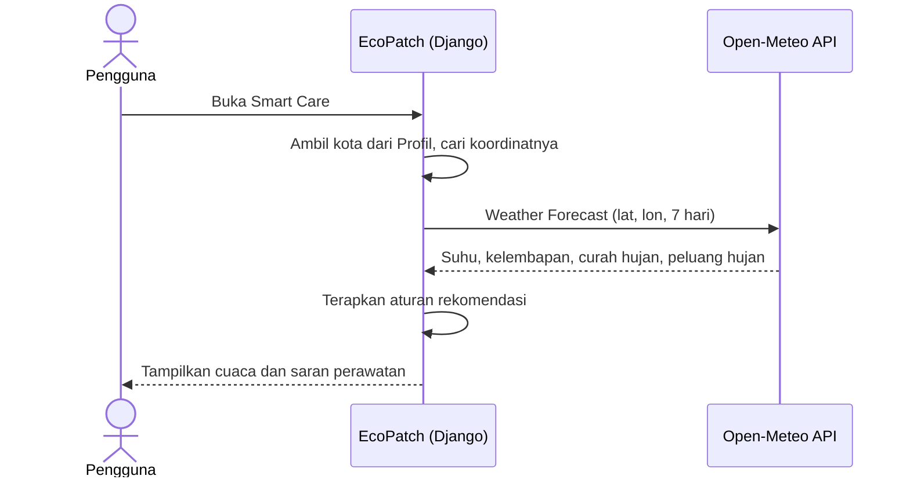

Contoh tampilannya di Smart Care:

```text
Today's Care · Depok
29°C · Kelembapan 78% · Peluang hujan 80% · Curah hujan 8 mm

Hujan cukup deras
Sekitar 8 mm hari ini. Tanaman outdoor mungkin tidak perlu disiram, cek tanah dulu.

[ ] Siram Cabai     [ ] Pupuk Tomat     [✓] Periksa Basil
```

Open-Meteo hanya penyedia data cuaca. **Aturan rekomendasinya dibuat dan dijalankan oleh EcoPatch.**

<details>
<summary><b>Data, kota, dan aturan rekomendasi</b></summary>

<br>

**Open-Meteo Weather Forecast API** dipakai di modul Smart Care.

**Data yang dipakai:** suhu, kelembapan relatif, curah hujan, peluang hujan, dan kode kondisi cuaca. Prakiraan 7 hari disimpan di cache selama 15 menit, dan bila Open-Meteo tidak menjawab dalam 5 detik, Smart Care tetap terbuka tanpa kartu cuaca.

**12 kota yang didukung:** Jakarta · Bogor · Depok · Tangerang · Bekasi · Bandung · Semarang · Yogyakarta · Surabaya · Malang · Medan · Makassar

Pengguna tidak perlu mengetik koordinat. Kota diambil dari Profil (bila kosong, dari kota EcoPatch, lalu Depok), dan koordinatnya disimpan sebagai data internal di `smart_care/weather.py`:

```python
CITIES = {
    "Jakarta": (-6.20, 106.81),
    "Bogor": (-6.59, 106.79),
    "Depok": (-6.40, 106.82),
    # ...
}
```

**Aturan rekomendasi.** Dari atas ke bawah, aturan pertama yang cocok menjadi headline kartu cuaca:

| Kondisi | Saran yang tampil |
| --- | --- |
| Peluang hujan ≥ 70% **dan** curah ≥ 5 mm | **Hujan cukup deras.** Tanaman outdoor mungkin tidak perlu disiram, cek tanah dulu. |
| Peluang hujan ≥ 70% tapi curah < 5 mm | **Hujan ringan.** Kemungkinan hanya gerimis, siram sesuai jadwal. |
| Suhu maksimum ≥ 32°C | **Cuaca panas.** Cek kelembapan media tanam. |
| Kelembapan ≥ 85% | **Udara lembap.** Periksa daun dari tanda jamur. |
| Selain itu | **Cuaca aman.** Waktu yang pas untuk merawat tanaman. |

Peluang hujan saja belum cukup untuk menyebut hari itu hujan, karena di musim hujan angkanya hampir selalu tinggi di sore hari walau hanya turun beberapa tetes. Karena itu aturan pertama juga menunggu curah hujan minimal 5 mm.

</details>

---

## 60 tanaman siap pakai

Plant Library langsung terisi setelah data awal dimuat dari fixture, jadi tidak ada katalog kosong di hari pertama.

| Kategori | Jumlah |
| --- | -: |
| Vegetables | 15 |
| Flowers | 12 |
| Herbs | 10 |
| Indoor / Low-Light Plants | 10 |
| Fruit / Container Plants | 8 |
| Aromatic / Useful Plants | 5 |
| **Total** | **60** |

---

## Siapa boleh melakukan apa

EcoPatch punya tiga jenis pengguna. Guest boleh melihat-lihat, Registered User mengelola data miliknya sendiri, dan Admin menjaga semuanya tetap rapi.

| | Guest | Registered User | Admin |
| --- | :-: | :-: | :-: |
| Lihat homepage, Plant Library, dan Seed Exchange | ✓ | ✓ | ✓ |
| Cari dan filter tanaman | ✓ | ✓ | ✓ |
| Buat dan kelola EcoPatch | – | ✓ | ✓ |
| Tambah tanaman ke EcoPatch | – | ✓ | ✓ |
| Buat Care Task dan lihat cuaca | – | ✓ | ✓ |
| Buat Garden Journal | – | ✓ | ✓ |
| Buat listing dan booking Seed Exchange | – | ✓ | ✓ |
| Atur profil (kota dan kontak) | – | ✓ | ✓ |
| Ubah atau hapus data **milik sendiri** | – | ✓ | ✓ |
| Kelola Plant Library dan master data | – | – | ✓ |
| Kelola pengguna dan data aplikasi | – | – | ✓ |
| Moderasi Seed Exchange | – | – | ✓ |

Guest tidak bisa mengubah atau menghapus data milik pengguna lain.

---

## Yang berubah tanpa reload halaman

| Modul | Interaksi dinamis |
| --- | --- |
| Plant Library | Hasil terfilter langsung berdasarkan kategori, sunlight, difficulty, dan indoor/outdoor. Klik kartu membuka detail dalam pop-up |
| My EcoPatch | Tanaman ditambahkan ke EcoPatch tanpa pindah halaman, juga lewat tombol **+** di Plant Library |
| Smart Care | Tombol **Mark as Completed** mengubah status Care Task |
| Garden Journal | Timeline difilter berdasarkan tanaman atau kondisi |
| Seed Exchange | Listing difilter berdasarkan Available, Give Away, atau Swap, dan booking langsung memperbarui kartunya |
| Semua modul | Tombol hapus membuka pop-up konfirmasi, bukan langsung menghapus |

---

## Di balik layar

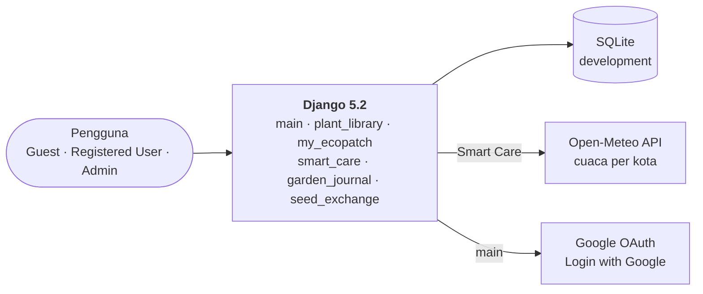

Data tiap modul punya relasi seperti ini:

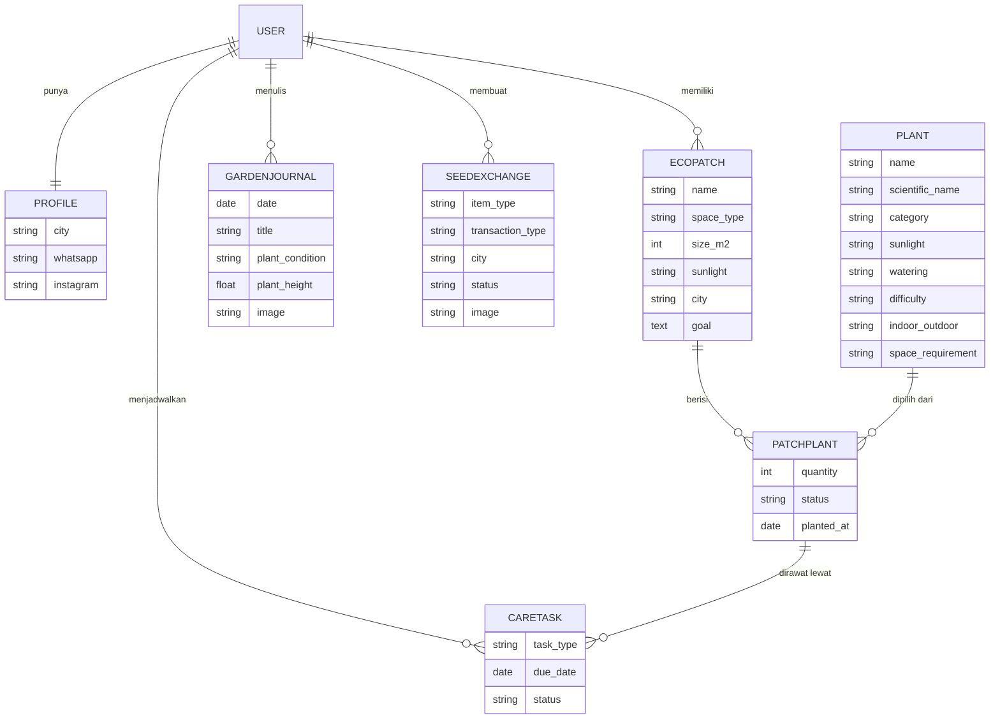

| Lapisan | Pilihan |
| --- | --- |
| Framework | Django 5.2 |
| Autentikasi | django-allauth (Login with Google) |
| Public API | Open-Meteo Weather Forecast |
| Static files | WhiteNoise |
| Server | Gunicorn |
| Database | SQLite untuk development. Driver PostgreSQL (`psycopg2-binary`) sudah tersedia. |
| Keamanan | Content-Security-Policy, cookie sesi dan CSRF `HttpOnly`, login dibatasi 5 percobaan gagal (dikunci 5 menit), semua teks dari pengguna di-escape di template |
| Pendukung | Pillow, python-dotenv |
| Deployment | PWS (Fasilkom UI) |

---

<a id="-jalankan-di-lokal"></a>

## Jalankan di lokal

```bash
git clone <url-repository> ecopatch-web
cd ecopatch-web

python -m venv .venv
source .venv/bin/activate          # Windows: .venv\Scripts\activate
pip install -r requirements.txt

cp .env.example .env               # opsional, lihat catatan di bawah
python manage.py migrate
python manage.py loaddata initial_plants   # 60 tanaman Plant Library
python manage.py createsuperuser           # untuk masuk ke /admin
python manage.py runserver
```

Lalu buka <http://127.0.0.1:8000/>.

- **Login with Google** butuh `GOOGLE_CLIENT_ID` dan `GOOGLE_CLIENT_SECRET` di `.env`. Tanpa keduanya, login biasa tetap jalan.
- **Email "Lupa password":** kosongkan `EMAIL_HOST` saat development, maka emailnya tercetak di terminal.
- **Contoh data Garden Journal (opsional):** `python manage.py seed_journal --username <username>`
- **Menjalankan test:** `python manage.py test` untuk semua modul, atau `python manage.py test smart_care` untuk satu modul.

---

## Struktur repository

```text
ecopatch-web/
├── ecopatch_project/     # settings dan URL utama
├── main/                 # homepage, autentikasi, profil, header keamanan
├── plant_library/        # Plant Library & Recommendation (+ fixtures/initial_plants.json)
├── my_ecopatch/          # EcoPatch dan PatchPlant
├── smart_care/           # Care Task dan cuaca Open-Meteo
├── garden_journal/       # Garden Journal
├── seed_exchange/        # Seed Exchange
├── templates/            # template HTML per modul
├── static/               # CSS, JS, dan aset (logo, diorama, maskot Petak)
└── docs/readme/          # gambar untuk README ini
```

**Branch utama:** `main`, `dev`

**Branch modul:** `feature/plant-library` · `feature/my-ecopatch` · `feature/smart-care` · `feature/garden-journal` · `feature/seed-exchange`

---

## Pengungkapan Penggunaan AI

Pengembangan EcoPatch melibatkan beberapa tools berbasis AI untuk implementasi, debugging, perancangan antarmuka, dan dokumentasi. **Seluruh anggota tim menggunakan AI**, tetapi pola dan tingkat pemakaiannya berbeda antaranggota dan antarmodul. Keputusan tentang perilaku fitur, aturan akses, desain, dan perubahan yang dipertahankan tetap dibuat anggota tim.

### 1. Tools AI dan perannya

| Tool | Digunakan oleh | Peran umum |
| --- | --- | --- |
| Claude Code | Nurul Fikryati Bena, Salwa Alifia Putri | Asisten coding berbasis agent |
| Codex | Haikal Rafka A Rahman | Asisten coding berbasis agent |
| Google Antigravity | Nur Azizah | Asisten coding berbasis agent |
| Figma Agent | Salwa Alifia Putri, Nur Azizah | Dukungan perancangan antarmuka |
| DeepSeek | Rheina Uliana | Asisten coding berbasis agent |
| ChatGPT / GPT | Percakapan proyek | Penjelasan konsep Django, pembacaan kode, debugging, pengujian, dan penyusunan dokumentasi |

Pemetaan tools per anggota berasal dari laporan tim. Rincian tugas per anggota untuk Claude Code, Codex, Antigravity, dan Figma Agent belum terdokumentasi.

<details>
<summary><b>2. Area yang dibantu AI</b></summary>

<br>

Tabel ini memetakan aktivitas yang tercatat. Bukan berarti seluruh kode pada area tersebut ditulis AI.

| Area | Contoh aktivitas |
| --- | --- |
| Django backend | Model, view, form, routing, query, dan validasi. Pada Seed Exchange: pemisahan listing milik pengguna, booking, dan listing yang dapat dijelajahi, serta alur status listing. |
| Authentication & authorization | Pembatasan aksi berdasarkan login, kepemilikan listing, dan status transaksi (misalnya edit atau hapus hanya untuk pemilik). |
| Templates & HTMX | Partial, kartu, form, halaman detail, empty state, konfirmasi hapus, serta perpindahan tab, filter, dan pencarian yang mempertahankan parameter URL. |
| CSS, responsive UI & aset visual | Tombol, spacing, dropdown, tampilan mobile, ilustrasi dan maskot SVG beranimasi, serta sistem form bersama lintas modul. |
| Testing & debugging | Menelusuri error, menjalankan Django checks dan test, iterasi setelah perilaku diperiksa di browser. |
| Git, integrasi & CI/CD | Branch, commit, merge, push, dan pull sesuai instruksi anggota. Workflow GitHub Actions untuk tes dan deploy ke PWS. |
| Pembelajaran & dokumentasi | Penjelasan konsep Django, HTMX, permission, dan testing, serta penyusunan dokumentasi proyek. |

</details>

<details>
<summary><b>3. Strategi prompt dan alur kerja</b></summary>

<br>

| Strategi | Contoh |
| --- | --- |
| Konteks proyek lebih dulu | Agent diminta membaca README dan struktur proyek sebelum mengubah modul yang ditugaskan. Repo ini punya `AGENTS.md` yang memuat pembagian modul dan larangan (jangan ubah modul orang lain, jangan push ke `main`, jangan menaruh rahasia di kode). |
| Instruksi perilaku spesifik | Memisahkan "Listing Saya", "Booking Saya", dan "Jelajahi". Kontak pemilik baru tampil setelah booking diterima. |
| Screenshot dan referensi visual | Melampirkan screenshot, lalu menunjuk elemen yang ukurannya, posisinya, atau spacing-nya belum sesuai. |
| Iterasi dari hasil pengujian | Melaporkan gejala (tab berpindah sendiri, filter hilang), lalu meminta revisi terarah setelah dicek ulang di browser. |
| Rencana dulu, baru eksekusi | Untuk perubahan besar, agent diminta menyusun rencana yang disetujui anggota sebelum mengubah kode. |
| Batasan ruang lingkup | Menetapkan branch kerja (memakai branch lama, bukan membuat yang baru), melarang mengubah file bersama, dan menetapkan format pesan commit. Commit dan push hanya dilakukan setelah diminta. |
| Meminta opsi dan penjelasan | Meminta pilihan refactor atau fitur kecil, penjelasan potongan kode, dan verifikasi temuan code review sebelum memutuskan apa yang diterapkan. |

Strategi di atas didukung oleh sesi Rheina (DeepSeek) dan sesi Salwa (Claude Code), dan tidak otomatis berlaku untuk semua anggota.

</details>

<details>
<summary><b>4. Review manusia, implementasi, dan verifikasi</b></summary>

<br>

- **Pemeriksaan di browser:** anggota membandingkan halaman dengan perilaku dan referensi yang diharapkan, lalu melaporkan perbedaannya.
- **Koreksi lanjutan:** ketika tab, filter, layout, atau ilustrasi belum sesuai, anggota menyampaikan gejala spesifik dan mengarahkan revisi berikutnya.
- **Keputusan ruang lingkup:** anggota menentukan branch, file yang boleh diubah, dan perubahan yang dipertahankan atau dikembalikan. Contohnya, hardening terhadap injection yang sempat ditambahkan dibatalkan dan hanya penanganan edge case yang dipertahankan.
- **Pencocokan dengan proyek:** hasil perubahan dicocokkan dengan model, nama field, URL, dan konvensi aplikasi.
- **Pengujian otomatis:** suite penuh repo (565 test, dijalankan pada branch deploy pada 30 Oktober 2026) lulus, dan `makemigrations --check` bersih. Keduanya juga dijalankan otomatis oleh GitHub Actions di setiap pull request. Sesi Rheina sebelumnya melaporkan 315 test lulus dan `manage.py check` tanpa masalah. Angka itu berasal dari laporan sesi dan tidak dijalankan ulang secara independen.
- **Review sebelum merge:** perubahan masuk lewat pull request dengan template yang memuat daftar centang tes, tampilan di ponsel, dan review oleh anggota lain.

Test otomatis tidak menggantikan pemeriksaan visual dan pengujian interaksi di browser. Riwayat commit juga tidak membuktikan apakah suatu baris ditulis manusia atau AI, karena sebagian commit dijalankan agent atas instruksi anggota.

</details>

### 5. Keterbatasan AI dan perbaikan manual

Ini bagian yang paling penting: AI tidak selalu benar, dan perbaikannya dikerjakan atau diverifikasi manusia.

| Temuan | Cara diketahui dan tindakan korektif |
| --- | --- |
| Agent membuat branch baru padahal diminta memakai branch fitur yang ada (sesi Rheina) | Anggota memeriksa branch aktif dan mengoreksi instruksi. Pekerjaan dilanjutkan di branch yang dimaksud. |
| Tab dan filter tidak konsisten: pilihan filter hilang atau tab berpindah sendiri (sesi Rheina) | Ditemukan lewat pengujian di browser. Agent menelusuri parameter request dan HTMX. Akar masalahnya adalah parameter `tab` duplikat dan `hx-include` yang membawa nilai lama. |
| Agent mengubah file bersama (`base.html`, `custom.css`) di luar modul yang diminta (sesi Rheina) | Anggota menemukannya dan meminta perubahan dikembalikan. Di-revert dengan `git checkout`. |
| Perubahan tidak tampil di browser (sesi Rheina) | Ternyata proses `runserver` lama masih berjalan. Server dimulai ulang. Masalahnya ada di lingkungan, bukan kode. |
| Maskot dan layout belum sesuai referensi (sesi Rheina) | Dibandingkan dengan screenshot dan direvisi beberapa kali, termasuk dibuat ulang sebagai SVG beranimasi. |
| Nested quotes pada atribut template menimbulkan error (sesi Rheina) | Handler diubah memakai atribut `data-` dan kutip tunggal. |
| Agent menyatakan working tree "bersih" padahal ada perubahan yang belum di-commit (sesi Salwa, Claude Code) | Terlihat dari keluaran `git status` pada langkah berikutnya. Klaimnya dikoreksi, dan perubahan itu diperiksa satu per satu sebelum di-commit. Pelajarannya: status Git dibaca dari keluaran perintah, bukan dari ingatan agent. |
| Agent menyarankan memuat 60 tanaman lewat Terminal PWS (`loaddata`), padahal terminal itu tidak bisa dipakai untuk itu (sesi Salwa, Claude Code) | Anggota menunjukkan bahwa langkah itu tidak berjalan di PWS. Solusinya diganti: seed otomatis setelah `migrate` yang diaktifkan variabel lingkungan `SEED_PLANTS_ON_MIGRATE`, lengkap dengan tes. |
| Pada header Smart Care, ikon cuaca digambar ulang sebagai SVG baru padahal fungsi `icon()` yang sama sudah ada, dan jarak ganda muncul di baris lokasi (sesi Salwa, Claude Code) | Ditemukan lewat review kode dan screenshot hasil render. Ikon diganti dengan memakai ulang `icon()`, jarak diperbaiki, dan tesnya disesuaikan. |
| Workflow CI yang dipakai ulang oleh workflow deploy dapat membatalkan CI dari push yang sama, sehingga deploy bisa terlewat (sesi Salwa, Claude Code) | Ditemukan saat meninjau ulang file sebelum dijalankan. Nama grup concurrency diubah memakai nama workflow. Perilaku akhirnya dibuktikan di GitHub: tes lalu deploy ke PWS berhasil. |
| Draf README awal menautkan dokumen yang diabaikan Git (`PRD.md`, `AGENTS.md`, dan lain-lain), sehingga tautannya mati di GitHub (sesi Salwa, Claude Code) | Ditemukan saat README diperiksa di salinan bersih repo. Tautan itu dihapus. |

Pelajaran utamanya: instruksi eksplisit tetap perlu diperiksa pada hasil aktual, perubahan lokal dapat berdampak lintas modul, kecocokan visual membutuhkan penilaian manusia, dan klaim agent tentang keadaan repo atau server harus dicek ulang.

<details>
<summary><b>6. Log percakapan dan dokumentasi prompt</b></summary>

<br>

| Materi | Status |
| --- | --- |
| Percakapan teknis ChatGPT | Dirujuk sebagai dasar klaim pembelajaran dan dokumentasi. Tidak ada tautan yang dibagikan |
| Log Claude Code, Codex, Antigravity, DeepSeek, Figma Agent | Tidak tersedia |
| Riwayat Git repository | Tersedia, menunjukkan waktu perubahan |

</details>

> AI digunakan sebagai alat bantu untuk eksplorasi, implementasi, debugging, dan dokumentasi. Kesesuaian dengan requirement, keputusan desain dan arsitektur, pemeriksaan hasil, serta tanggung jawab atas kualitas akhir tetap berada pada anggota tim.

---

<a id="-tim"></a>

## Tim

Setiap anggota memegang satu modul (PIC) beserta model utamanya.

<table>
  <tr>
    <td align="center" width="20%"><br><b>Nurul Fikryati Bena</b><br><code>2506534825</code><br><b>PIC Plant Library</b><br><code>Plant</code></td>
    <td align="center" width="20%"><br><b>Haikal Rafka A Rahman</b><br><code>2506553383</code><br><b>PIC My EcoPatch</b><br><code>EcoPatch</code>, <code>PatchPlant</code></td>
    <td align="center" width="20%"><br><b>Salwa Alifia Putri</b><br><code>2506620280</code><br><b>PIC Smart Care</b><br><code>CareTask</code></td>
    <td align="center" width="20%"><br><b>Nur Azizah</b><br><code>2506547935</code><br><b>PIC Garden Journal</b><br><code>GardenJournal</code></td>
    <td align="center" width="20%"><br><b>Rheina Uliana</b><br><code>2506600801</code><br><b>PIC Seed Exchange</b><br><code>SeedExchange</code></td>
  </tr>
</table>

<br>

<div align="center">

**Small Spaces, Greener Living**

Dibuat dengan Django · Proyek Tengah Semester PBP Gasal 2026/2027

</div>
